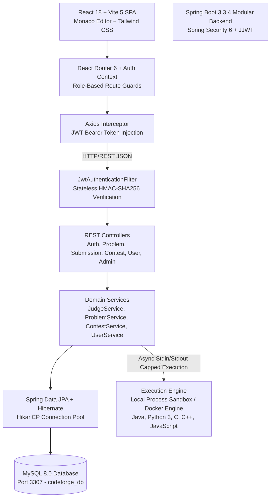
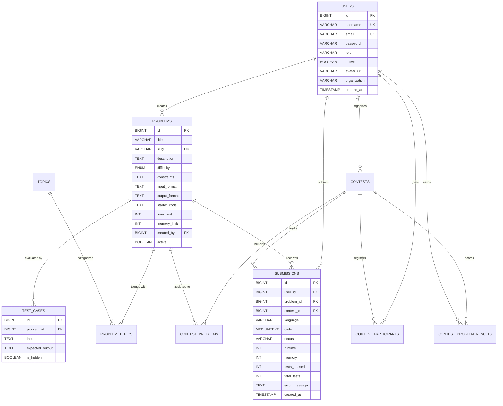

# CodeForge ⚡
### Modern Competitive Programming & Online Judge Platform


-success?style=for-the-badge&logo=junit5&logoColor=white)

**CodeForge** is an enterprise-grade competitive programming and automated online judge platform built with **Spring Boot 3.3.4**, **React 18**, **Vite 5**, **MySQL 8.0**, and Microsoft's **Monaco Editor**. Designed with modern engineering aesthetics inspired by LeetCode and Codeforces, CodeForge delivers automated multi-language sandboxed code execution, live contest scoring, ICPC-style penalty tracking, authentic user analytics, and role-based access control.

---

## 📑 Table of Contents

- [1. System Architecture & Tech Stack](#1-system-architecture--tech-stack)
- [2. Key Features & Platform Capabilities](#2-key-features--platform-capabilities)
- [3. Database Schema & ER Diagram](#3-database-schema--er-diagram)
- [4. Security Architecture & Threat Model](#4-security-architecture--threat-model)
- [5. Sandbox Code Execution Engine](#5-sandbox-code-execution-engine)
- [6. Project Directory Structure](#6-project-directory-structure)
- [7. Quick Start & Setup Guide](#7-quick-start--setup-guide)
- [8. Default Seed Demo Accounts](#8-default-seed-demo-accounts)
- [9. Complete REST API Reference](#9-complete-rest-api-reference)
- [10. Automated Testing Guide & Test Results](#10-automated-testing-guide--test-results)
- [11. Troubleshooting & FAQ](#11-troubleshooting--faq)
- [12. Major Project Demonstration Checklist](#12-major-project-demonstration-checklist)
- [13. Known Limitations & Roadmap](#13-known-limitations--roadmap)
- [14. License](#14-license)

---

## 1. System Architecture & Tech Stack



### Technology Matrix

| Layer | Component | Version / Specification | Rationale & Responsibility |
| :--- | :--- | :--- | :--- |
| **Frontend** | React SPA | React 18.3.1 | Component-driven reactive client with split-pane layout |
| **Build Tool** | Vite | Vite 5.4.21 | Sub-second HMR and optimized production bundle compilation |
| **Styling** | Tailwind CSS | Tailwind 3.4.14 | Minimalist dark/light mode UI with customized design tokens |
| **Code Editor**| Monaco Editor | `@monaco-editor/react` | Industry-standard IDE experience with multi-language syntax highlighting |
| **Backend** | Spring Boot | 3.3.4 (Java 17 / 25) | Enterprise REST API foundation with high concurrency and strict typing |
| **Security** | Spring Security | 6.3.3 + JJWT 0.12.6 | BCrypt password hashing, stateless JWT claims, and method-level RBAC |
| **ORM** | Spring Data JPA| Hibernate 6.5.3 | Type-safe transactional repositories with parameterized SQL queries |
| **Database** | MySQL | 8.0 (InnoDB) | ACID-compliant relational persistence with foreign keys and unique constraints |
| **Code Judge** | Native / Docker | LocalSandbox / Docker | Process isolation, timeouts, memory ceilings, and deadlock-free stream reading |

---

## 2. Key Features & Platform Capabilities

### 💻 Monaco Code Workspace
- **Zero State-Bleed**: Language and code editor states are strictly cached per problem ID and language; switching between Java, Python, C++, C, or JavaScript preserves work without race conditions.
- **Split-Pane Layout**: Collapsible problem statements, LaTeX constraints, sample test cases, and editorial solutions on the left; editor, language picker, and console drawer on the right.
- **Real-Time Light/Dark Theme**: Seamlessly synchronizes application theme and Monaco themes (`vs-dark` and `light`).

### ⚡ Isolated Code Execution
- **Run vs. Submit**:
  - **Run Code**: Tests code against public sample cases or arbitrary custom stdin inputs without exposing edge cases.
  - **Submit Code**: Grades code against complete hidden test suites with strict time and memory limits.
- **Verdict Diagnostics**: Instant verdicts (`ACCEPTED`, `WRONG_ANSWER`, `COMPILATION_ERROR`, `TIME_LIMIT_EXCEEDED`, `RUNTIME_ERROR`) with line-numbered compiler error logs and unified whitespace-insensitive diffs.
- **Deadlock-Free I/O**: Stream readers use asynchronous buffers capped at 64 KB to eliminate process pipe deadlocks on massive output streams.

### 🏆 Contests & Deterministic Leaderboards
- **Live Lifecycle**: Server-side enforced states: `UPCOMING`, `LIVE`, and `COMPLETED`. Submissions outside active windows are rejected.
- **ICPC Scoring & Standings**:
  $$\text{Penalty} = \text{Solve Time (minutes)} + (\text{Wrong Attempts} \times 20)$$
- **Deterministic Tie-Breaking**: Ranked by (1) problems solved descending, (2) penalty minutes ascending, (3) earlier timestamp of the final accepted submission.

### 📊 Authentic Performance Analytics
- **Genuine Streak Counter**: Real consecutive active days calculation derived exclusively from persisted submissions (no fabricated default minimums).
- **Topic Mastery**: Accuracy tracking per DSA topic (Arrays, Strings, Dynamic Programming, Trees, etc.).
- **Weak-Topic Detection**: Identifies topics with $<50\%$ accuracy or high failed attempts.
- **Rule-Based Recommendations**: Automatically suggests the next 3–5 unsolved problems matching the user's target difficulty and weak topics.

---

## 3. Database Schema & ER Diagram

The database utilizes MySQL 8.0 InnoDB engine with full referential integrity and cascading rules.



---

## 4. Security Architecture & Threat Model

```
┌────────────────────────────────────────────────────────────────────────┐
│                        Threat Model & Defenses                         │
├────────────────────────────────┬───────────────────────────────────────┤
│ Attack Vector                  │ Defense Mechanism Implemented         │
├────────────────────────────────┼───────────────────────────────────────┤
│ Privilege Escalation           │ Backend blocks self-assignment of     │
│ (Self-registration as ADMIN)   │ ROLE_ADMIN in AuthService.            │
├────────────────────────────────┼───────────────────────────────────────┤
│ Information Disclosure         │ is_hidden test cases strictly         │
│ (Leaking Hidden Test Cases)    │ filtered out of public APIs.          │
├────────────────────────────────┼───────────────────────────────────────┤
│ Unauthorized Submission Access │ Submissions viewable only by owner    │
│ (Reading peer source code)     │ or authorized administrators.         │
├────────────────────────────────┼───────────────────────────────────────┤
│ Cross-Organizer Contest Access │ Contest analytics endpoints enforce   │
│ (Viewing peer contest metrics) │ creator ownership verification.       │
├────────────────────────────────┼───────────────────────────────────────┤
│ Fork Bomb / Resource Bomb      │ OS process-tree termination on        │
│ (Malicious infinite loops)     │ timeout; static CodeSanitizer filters.│
├────────────────────────────────┼───────────────────────────────────────┤
│ Buffer Deadlock / Heap Denial  │ Asynchronous 64 KB capped stream      │
│ (Giant output floods)          │ readers prevent pipe blocking.        │
└────────────────────────────────┴───────────────────────────────────────┘
```

1. **Password Security**: Passwords hashed using BCrypt (`BCryptPasswordEncoder`, strength 10). Plaintext passwords and hashes are never exposed in API responses.
2. **Stateless JWT Verification**: HMAC-SHA256 signature verification with 256-bit secret key. Rejects expired, tampered, or malformed tokens.
3. **Role-Based Access Control (RBAC)**:
   - `ROLE_PARTICIPANT`: Access public problems, sample tests, personal submissions, and profile analytics.
   - `ROLE_ORGANIZER`: Create/manage owned contests, contest problems, and contest analytics.
   - `ROLE_ADMIN`: Full access to problem CRUD, test case creation, user roles, and system telemetry.

---

## 5. Sandbox Code Execution Engine

CodeForge uses a dual-engine architecture:

1. **Docker Engine Isolation (`DockerCodeExecutor.java`)**: When Docker daemon is present on a host, submissions run in ephemeral isolated containers (`--network none`, read-only roots, non-root user).
2. **Process-Isolated Local Sandbox (`LocalSandboxExecutor.java`)**: When Docker is unavailable (such as local Windows development environments), execution falls back to a secured local process runner:
   - Static analysis via `CodeSanitizer.java` prevents high-risk calls (`ProcessBuilder`, `Runtime.getRuntime()`, `System.exit()`, `os.system`, `subprocess`, `fork()`, `system()`).
   - Execution runs with dedicated per-submission working directories cleaned up immediately after evaluation.
   - Process watchdog forcibly kills the entire process tree upon timeout expiration.
   - Transparent host telemetry displays current engine status on the admin dashboard (`STANDALONE` vs. `ACTIVE (Docker)`).

### Supported Compilers & Interpreters
- **Java**: OpenJDK 17 / 25 (`javac`, `java`)
- **Python**: Python 3.10+ (`python`)
- **C++**: GCC / G++ 6.3+ (`g++ -O2 -std=c++17`)
- **C**: GCC (`gcc -O2`)
- **JavaScript**: Node.js (`node`)

---

## 6. Project Directory Structure

```
CodeForge/
├── backend/                             # Spring Boot 3.3.4 Application
│   ├── src/main/java/com/codeforge/
│   │   ├── admin/controller/           # Admin telemetry & user management
│   │   ├── auth/                       # JWT auth, register, login, logout
│   │   ├── common/                     # Unified ApiResponse & error models
│   │   ├── config/                     # Security, CORS, and Data Initializer
│   │   ├── contest/                    # Contest entities, standings, and organizer APIs
│   │   ├── exception/                  # Sanitized GlobalExceptionHandler
│   │   ├── execution/                  # JudgeService, LocalSandbox, DockerExecutor
│   │   ├── problem/                    # Problem CRUD, difficulty, and topics
│   │   ├── security/                   # JwtTokenProvider, CustomUserDetailsService
│   │   ├── submission/                 # Run/submit handlers & grading pipelines
│   │   ├── testcase/                   # TestCase entities and repositories
│   │   ├── topic/                      # DSA topic entities & repositories
│   │   └── user/                       # User profiles, streak, and recommendations
│   ├── src/main/resources/
│   │   └── application.yml             # Externalized environment configuration
│   └── pom.xml                          # Maven build dependencies
├── frontend/                            # React 18 + Vite 5 Application
│   ├── src/
│   │   ├── api/                        # Axios instance with auth interceptors
│   │   ├── components/                 # Navbar, Badges, Modals, Guards
│   │   ├── context/                    # AuthContext and ThemeContext
│   │   ├── pages/                      # 10 Responsive views (Problems, Editor, Profile, etc.)
│   │   ├── index.css                   # Tailwind CSS styling and theme overrides
│   │   └── App.jsx                     # Route definitions & protected route guards
│   ├── package.json
│   └── vite.config.js
├── database/                            # Database initialization scripts
│   ├── schema.sql                      # DDL schema definition
│   ├── seed_data.sql                   # Sample problems, contests, and test cases
│   └── setup_database.sql              # Combined bootstrap script
├── docs/                                # Technical documentation
│   ├── api.md                          # REST API specification
│   ├── architecture.md                 # Architecture flow & component diagrams
│   ├── database.md                     # Data dictionary & ER diagram
│   └── setup.md                        # Presentation & viva preparation guide
├── mysql-data/                          # Local MySQL 8.0 data directory (Port 3307)
├── .env.example                         # Environment configuration template
├── .gitignore                           # Git ignore rules
├── run.bat                              # One-click Windows CMD launcher
├── run.ps1                              # One-click Windows PowerShell launcher
└── README.md                            # Main project documentation
```

---

## 7. Quick Start & Setup Guide

### Prerequisites
- **Java JDK 17 or higher** (`java -version`, `javac -version`)
- **Node.js 18+ and npm** (`node -v`, `npm -v`)
- **Apache Maven 3.9+** (`mvn -v`)
- **MySQL 8.0 Server** (running on port `3307` or `3306`)

---

### Step 1: Start MySQL Database
CodeForge includes a dedicated, pre-seeded MySQL data directory on port `3307`:
```powershell
& "C:\Program Files\MySQL\MySQL Server 8.0\bin\mysqld.exe" --datadir=".\mysql-data" --port=3307 --console
```
*Note: If using your system MySQL on port 3306, update `MYSQL_PORT=3306` in your environment or run `database/setup_database.sql`.*

---

### Step 2: Start Spring Boot Backend
```powershell
cd backend
mvn spring-boot:run
```
- Backend REST API: **`http://localhost:8080`**
- Health Check: **`http://localhost:8080/api/health`**

---

### Step 3: Start React Frontend
In a new terminal window:
```powershell
cd frontend
npm install
npm run dev
```
- Web Application: **`http://localhost:5173`**

---

### One-Click Start (Windows)
To start both backend and frontend simultaneously:
```powershell
.\run.ps1
```
*(Or double-click `run.bat`)*

---

## 8. Default Seed Demo Accounts

CodeForge automatically initializes accounts for all three user roles:

| Role | Username | Password | Accessible Capabilities |
| :--- | :--- | :--- | :--- |
| **Admin** | `admin` | `admin123` | Full administrative control, Problem CRUD, Test Case management, User management, System telemetry |
| **Organizer** | `organizer` | `organizer123` | Contest Studio, Contest Creation, Problem assignment, Live contest analytics |
| **Participant** | `john_doe` | `user123` | Solve problems, Monaco Editor (Run/Submit), Real-time streak, Profile analytics & recommendations |

---

## 9. Complete REST API Reference

All responses conform to the standard structure:
```json
{
  "success": true,
  "message": "Operation successful",
  "data": { ... }
}
```

| Method | Endpoint | Access Level | Description |
| :--- | :--- | :--- | :--- |
| `POST` | `/api/auth/register` | Public | Register participant or organizer account |
| `POST` | `/api/auth/login` | Public | Authenticate user and receive JWT Bearer token |
| `POST` | `/api/auth/logout` | Authenticated | Invalidate authentication session |
| `GET` | `/api/auth/me` | Authenticated | Validate token and retrieve user claims |
| `GET` | `/api/problems` | Public | List problems with search, difficulty, and pagination |
| `GET` | `/api/problems/{id}` | Public | Problem statement, constraints, and public sample test cases |
| `POST` | `/api/submissions/run` | Public/Auth | Execute code against sample cases or custom stdin input |
| `POST` | `/api/submissions` | Authenticated | Submit code for full evaluation against hidden test suite |
| `GET` | `/api/submissions/my` | Authenticated | Retrieve authenticated user's submission history |
| `GET` | `/api/submissions/{id}`| Owner / Admin | Retrieve source code and execution metrics of a submission |
| `GET` | `/api/users/me/stats` | Authenticated | Real-time statistics, streak, topic accuracy, and recommendations |
| `PUT` | `/api/users/me` | Authenticated | Update user avatar URL or profile settings |
| `GET` | `/api/users/leaderboard`| Public | Global user rankings based on problems solved and accuracy |
| `GET` | `/api/contests` | Public | List upcoming, live, and past competitive contests |
| `GET` | `/api/contests/{id}` | Public | Detailed contest metadata, rules, and problem assignments |
| `GET` | `/api/contests/{id}/leaderboard` | Public | Live ICPC-style contest standings with penalty metrics |
| `POST` | `/api/organizer/contests` | `ROLE_ORGANIZER` | Create a new contest with problem and score mappings |
| `GET` | `/api/organizer/contests/{id}/analytics` | Creator / Admin | View contest participation and problem solve analytics |
| `POST` | `/api/admin/problems` | `ROLE_ADMIN` | Author a new DSA problem with hidden test cases |
| `PUT` | `/api/admin/problems/{id}` | `ROLE_ADMIN` | Update problem statement, constraints, or test cases |
| `DELETE`| `/api/admin/problems/{id}` | `ROLE_ADMIN` | Remove problem and associated test cases |
| `GET` | `/api/admin/stats` | `ROLE_ADMIN` | Aggregate platform telemetry (users, problems, submissions) |
| `GET` | `/api/admin/logs` | `ROLE_ADMIN` | Live JVM memory, database status, and sandbox engine telemetry |

---

## 10. Automated Testing Guide & Test Results

Run the complete backend regression test suite:
```powershell
cd backend
mvn test
```

### Verified Test Suite Breakdown (32 / 32 Passed)

```
✓ com.codeforge.auth.AuthServiceTest (8 tests)
  - Registration success with BCrypt password encoding
  - Rejection of duplicate username and duplicate email
  - Rejection of password confirmation mismatch
  - Rejection of self-assigned ROLE_ADMIN during registration
  - Authentication login with valid and invalid credentials
  - JWT token generation and claims parsing
  - Rejection of malformed, empty, and null JWT tokens

✓ com.codeforge.execution.ExecutionSecurityTest (5 tests)
  - Compilation failure handling and error log sanitization
  - Time Limit Exceeded (TLE) watchdog process termination
  - Runtime Error (division by zero, exception traces) handling
  - Accepted solution evaluation with normalized CRLF/whitespace comparison
  - Sample code execution isolation (never leaks hidden test cases)

✓ com.codeforge.execution.JudgeEngineTest (6 tests)
  - Java dangerous token sanitization (Runtime, ProcessBuilder, reflection)
  - Python dangerous token sanitization (os, subprocess, eval, sockets)
  - C++ restricted calls sanitization (system, popen, fork, kill)
  - Output normalization and whitespace neutrality
  - Line ending and token stream comparison correctness

✓ com.codeforge.contest.ContestScoringTest (2 tests)
  - Deterministic ICPC standings ranking with wrong attempt penalties
  - Tie-breaking by earlier solve timestamp when penalty minutes are identical

✓ com.codeforge.user.UserAnalyticsTest (3 tests)
  - Authentic streak calculation (streak = 0 when no recent submission)
  - Consecutive active days streak incrementation
  - Weak-topic detection (<50% accuracy) and unsolved problem recommendations

✓ com.codeforge.user.UserServiceTest (1 test)
  - User profile statistics aggregation and solved counts by difficulty

✓ com.codeforge.problem.ProblemServiceTest (3 tests)
  - Problem retrieval with public sample cases
  - Search by topic and keyword
  - Difficulty-wise filtering

✓ com.codeforge.submission.SubmissionServiceTest (3 tests)
  - Submission creation, persistence, and ownership enforcement
  - Rejection of unauthorized submission inspection

✓ com.codeforge.CodeForgeApplicationTests (1 test)
  - Full Spring Boot Application Context boot test
```

### Frontend Production Build
```powershell
cd frontend
npm run build
```
*Builds cleanly into optimized static assets in `frontend/dist/` without compilation warnings or errors.*

---

## 11. Troubleshooting & FAQ

### 1. MySQL Connection Refused / Port Conflict
- **Problem**: `Communications link failure` on startup.
- **Cause**: By default, `application.yml` connects to port `3307` where the workspace MySQL data directory lives.
- **Solution**: Start the dedicated MySQL instance with:
  ```powershell
  & "C:\Program Files\MySQL\MySQL Server 8.0\bin\mysqld.exe" --datadir=".\mysql-data" --port=3307 --console
  ```
  Or change `MYSQL_PORT=3306` in your environment if running a standard service.

### 2. Execution Sandbox Reports Local Mode Instead of Docker
- **Observation**: Admin telemetry reports `"STANDALONE (Local Process-Isolated Sandbox; Docker unavailable on host)"`.
- **Explanation**: This is expected when Docker is not installed on the host. The local sandbox safely evaluates code using native compilers with timeouts and static analysis. To enable Docker isolation, install Docker Desktop and set `DOCKER_ENABLED=true`.

### 3. Java 25 Native Access Warnings
- **Observation**: Maven outputs `WARNING: Use --enable-native-access=ALL-UNNAMED`.
- **Explanation**: Java 25 LTS outputs informational warnings regarding legacy native libraries (e.g. Jansi, Tomcat embed). These warnings do not affect platform functionality or test execution.

---

## 12. Major Project Demonstration Checklist

Follow this workflow for an end-to-end college or viva project demonstration:

- [ ] **1. Authentication & Security**:
  - Open `http://localhost:5173/register`. Attempt to find the `ROLE_ADMIN` option (verified removed). Register a new `Participant` account.
  - Log in with `john_doe` / `user123`. Verify session persistence and JWT bearer authorization.
- [ ] **2. Problem Bank & Monaco Editor**:
  - Browse `/problems`. Filter by `Easy`, search for `Two Sum`, and open the problem detail view.
  - Switch languages between Java, Python, and C++. Verify code template isolation without cross-language code bleeding.
  - Test custom input in the bottom console drawer and click **Run Code**. Verify real-time output.
  - Submit an incorrect solution; verify `WRONG_ANSWER` verdict. Submit the optimal solution; verify `ACCEPTED` verdict.
- [ ] **3. User Analytics & Recommendations**:
  - Navigate to `/profile`.
  - Verify genuine streak counter, difficulty progress bars, topic mastery, and 3–5 recommended next problems.
- [ ] **4. Contests & Leaderboards**:
  - Navigate to `/contests`. Open an active contest.
  - Inspect the ICPC-style leaderboard with problem solve times, wrong attempt penalties, and deterministic tie-breaking.
- [ ] **5. Admin Control Panel**:
  - Log out and log in as `admin` / `admin123`.
  - Navigate to `/admin`. Inspect live JVM memory telemetry, MySQL status, and sandbox engine status.
  - Create a new problem with both public sample cases and hidden evaluation cases.

---

## 13. Known Limitations & Roadmap

1. **Docker Containerization**: On Windows host environments without Docker Desktop, execution runs via process isolation. In enterprise Linux deployments, containerized execution (`--network none`, cgroups v2 memory limits) is supported.
2. **Additional Language Runtimes**: Currently supports Java, Python 3, C, C++, and JavaScript. Future releases can add Rust, Go, and Kotlin compilers.
3. **Automated Submission Queue**: High-throughput distributed scaling can be augmented with a Redis-backed submission queue when migrating beyond the modular monolith architecture.

---

## 14. License

This project is developed for academic, educational, and competitive programming purposes under the **MIT License**.
