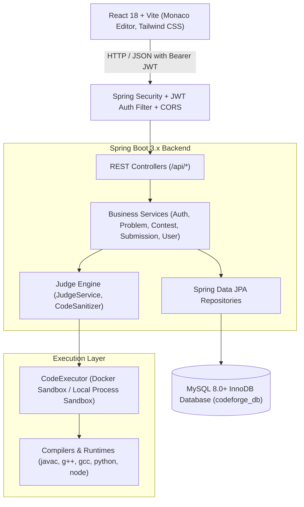
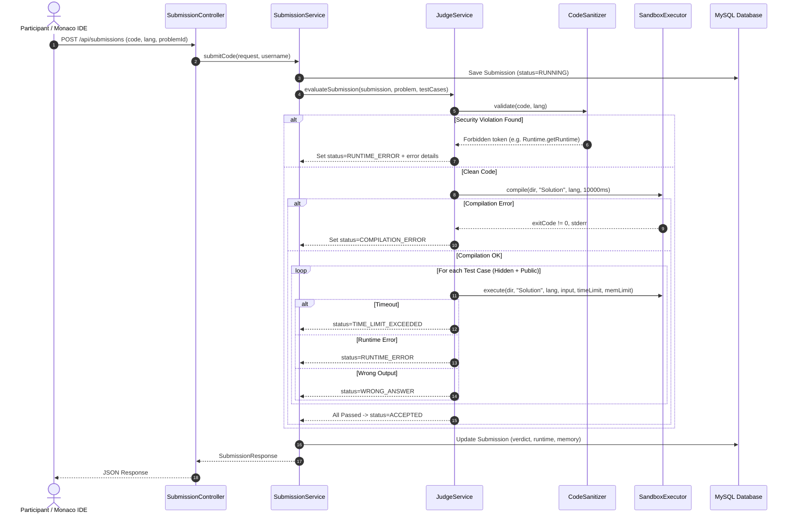

# CodeForge System Architecture

## Overview

**CodeForge** is an enterprise-grade competitive programming and algorithmic evaluation platform engineered for college and university coding clubs, hackathons, and individual practice. It features a layered architecture separating concerns between web presentation, business logic, data persistence, and sandboxed code execution.

---

## 1. High-Level Architecture Diagram

---

## 2. Layered Backend Design

The backend strictly conforms to the enterprise layered pattern:

$$\text{HTTP Request} \longrightarrow \text{Controller} \longrightarrow \text{Service} \longrightarrow \text{Repository} \longrightarrow \text{Entity} \longrightarrow \text{Database}$$

### 2.1 Controller Layer (`com.codeforge.*.controller`)
- Validates incoming HTTP requests via Jakarta Bean Validation (`@Valid`).
- Extracts authentication principals via `@AuthenticationPrincipal` or `Authentication`.
- Returns standard envelopes (`ApiResponse<T>`) with HTTP status codes.
- Does not contain business logic or transactional state.

### 2.2 Service Layer (`com.codeforge.*.service`)
- Enforces business rules (e.g., verifying contest status before submission, ensuring unique slugs).
- Manages transactional boundaries with `@Transactional`.
- Transforms entity graphs into Data Transfer Objects (`*Dto`).

### 2.3 Repository Layer (`com.codeforge.*.repository`)
- Extends Spring Data JPA `JpaRepository`.
- Implements custom JPQL queries with index-optimized lookups.
- Avoids N+1 query overhead through targeted joins and pagination.

### 2.4 Entity Layer (`com.codeforge.*.entity`)
- JPA entities mapped to MySQL 8 InnoDB tables.
- Strict foreign key constraints and cascade rules.
- Automatic auditing via `@PrePersist` timestamps.

---

## 3. Code Execution & Judge System

### Supported Languages & Runtimes:
1. **Java 17+** (`javac`, `java -Xmx<limit>m`)
2. **C++ (C++17)** (`g++ -O3 -std=c++17 Solution.cpp -o Solution.exe`)
3. **C (C11)** (`gcc -O3 Solution.c -o Solution.exe`)
4. **Python 3** (`python Solution.py`)
5. **JavaScript (Node.js)** (`node Solution.js`)

### Security Controls:
- **Sandbox Isolation:** Temporary per-execution directories automatically destroyed in `finally` blocks.
- **Process Boundaries:** OS process limits, timeout termination (`waitFor(timeout, TimeUnit.MILLISECONDS)` followed by `process.destroyForcibly()`).
- **CodeSanitizer Validation:** Static regex inspection blocking unauthorized process invocation, system shutdown, destructive file I/O, and socket binding.
- **Output Truncation & Normalization:** Prevents output bombing; normalizes CRLF and trailing whitespace before verification.

---

## 4. Contest Engine & ICPC Scoring

- **Contest Life Cycle:**
  - `UPCOMING`: Scheduled in the future; registrations open.
  - `LIVE`: Active tournament; problem statements unlocked; live countdown timer.
  - `COMPLETED`: Ended; final scoreboard locked.
- **ICPC Penalty Calculation:**
  $$\text{Penalty} = \text{Elapsed Solve Time (minutes)} + (\text{Wrong Attempts} \times 20\text{ minutes})$$
- **Live Leaderboard:**
  Ranked by:
  1. Primary: Problems solved (descending)
  2. Secondary: Score (descending)
  3. Tertiary: Penalty minutes (ascending)
