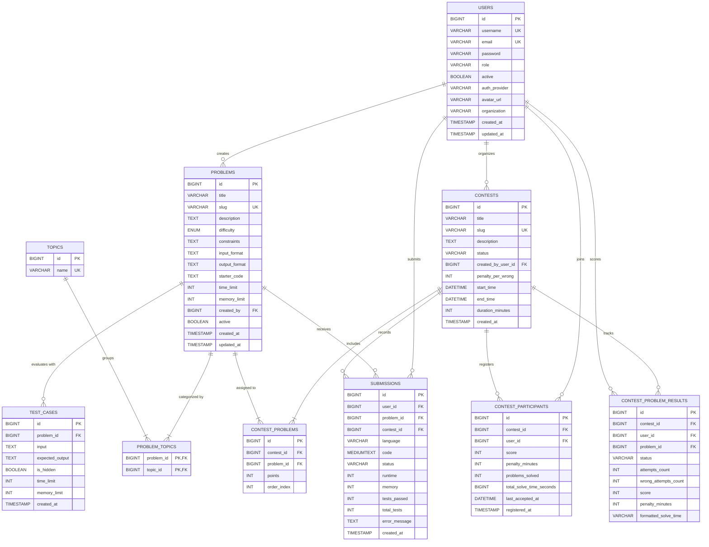

# CodeForge Database Architecture & Schema Specification

Target Database Management System: **MySQL 8.0+ (InnoDB Engine)**  
Default Database Name: `codeforge_db`  
Character Set: `utf8mb4`  
Collation: `utf8mb4_unicode_ci`  

---

## 1. Relational Entity-Relationship Diagram



---

## 2. Data Dictionary

### 2.1. `users` Table
Stores user credentials, role allocations, profile metadata, and activity status.

| Column | Type | Constraints | Description |
| :--- | :--- | :--- | :--- |
| `id` | `BIGINT` | `PK`, `AUTO_INCREMENT` | Unique user identifier |
| `username` | `VARCHAR(50)` | `NOT NULL`, `UNIQUE` | Unique user handle (indexed) |
| `email` | `VARCHAR(100)` | `NOT NULL`, `UNIQUE` | Contact & login email (indexed) |
| `password` | `VARCHAR(255)` | `NOT NULL` | BCrypt cryptographic hash (cost factor: 10) |
| `role` | `VARCHAR(30)` | `NOT NULL`, `DEFAULT 'ROLE_PARTICIPANT'` | `ROLE_ADMIN`, `ROLE_ORGANIZER`, `ROLE_PARTICIPANT` |
| `active` | `BOOLEAN` | `NOT NULL`, `DEFAULT TRUE` | Soft-deactivation status |
| `auth_provider` | `VARCHAR(20)` | `DEFAULT 'LOCAL'` | Authentication mechanism |
| `avatar_url` | `VARCHAR(500)` | `NULLABLE` | URL to user's profile image |
| `organization` | `VARCHAR(150)` | `DEFAULT 'CodeForge Tech'` | University or company name |
| `created_at` | `TIMESTAMP` | `DEFAULT CURRENT_TIMESTAMP` | Account registration timestamp |
| `updated_at` | `TIMESTAMP` | `ON UPDATE CURRENT_TIMESTAMP` | Profile last modified timestamp |

**Indexes**:
- `idx_users_username` (`username`)
- `idx_users_email` (`email`)
- `idx_users_role` (`role`)

---

### 2.2. `problems` Table
Contains algorithmic problem definitions, time/memory limits, difficulty tags, and starter code templates.

| Column | Type | Constraints | Description |
| :--- | :--- | :--- | :--- |
| `id` | `BIGINT` | `PK`, `AUTO_INCREMENT` | Problem numeric identifier |
| `title` | `VARCHAR(150)` | `NOT NULL` | Human-readable problem title |
| `slug` | `VARCHAR(150)` | `NOT NULL`, `UNIQUE` | URL-friendly slug (e.g. `two-sum`) |
| `description` | `TEXT` | `NOT NULL` | Problem statement in Markdown |
| `difficulty` | `ENUM('EASY','MEDIUM','HARD')` | `NOT NULL` | Problem difficulty rating |
| `constraints` | `TEXT` | `NULLABLE` | Input constraints ($1 \le N \le 10^5$) |
| `input_format` | `TEXT` | `NULLABLE` | Description of standard input stream |
| `output_format` | `TEXT` | `NULLABLE` | Description of expected standard output |
| `starter_code` | `TEXT` | `NULLABLE` | Default starter boilerplate for Monaco Editor |
| `time_limit` | `INT` | `NOT NULL`, `DEFAULT 1000` | Execution time limit in milliseconds |
| `memory_limit` | `INT` | `NOT NULL`, `DEFAULT 256` | Maximum resident memory in megabytes |
| `created_by` | `BIGINT` | `FK -> users(id) ON DELETE SET NULL` | Author user ID |
| `active` | `BOOLEAN` | `NOT NULL`, `DEFAULT TRUE` | Active visibility flag |
| `created_at` | `TIMESTAMP` | `DEFAULT CURRENT_TIMESTAMP` | Problem creation timestamp |
| `updated_at` | `TIMESTAMP` | `ON UPDATE CURRENT_TIMESTAMP` | Last modified timestamp |

**Indexes**:
- `idx_problems_difficulty` (`difficulty`)
- `idx_problems_slug` (`slug`)
- `idx_problems_active` (`active`)

---

### 2.3. `topics` & `problem_topics` Tables
Provides many-to-many DSA categorization tags (e.g., Arrays, Dynamic Programming, Graphs).

- **`topics`**: `id` (`PK`), `name` (`VARCHAR(50)`, `UNIQUE`).
- **`problem_topics`**: `problem_id` (`FK -> problems(id) ON DELETE CASCADE`), `topic_id` (`FK -> topics(id) ON DELETE CASCADE`). Composite Primary Key `(problem_id, topic_id)`.

---

### 2.4. `test_cases` Table
Stores input/output evaluation suites for automated judging.

| Column | Type | Constraints | Description |
| :--- | :--- | :--- | :--- |
| `id` | `BIGINT` | `PK`, `AUTO_INCREMENT` | Test case identifier |
| `problem_id` | `BIGINT` | `FK -> problems(id) ON DELETE CASCADE` | Associated problem |
| `input` | `TEXT` | `NOT NULL` | Standard input fed to execution sandbox |
| `expected_output` | `TEXT` | `NOT NULL` | Strict benchmark output |
| `is_hidden` | `BOOLEAN` | `NOT NULL`, `DEFAULT FALSE` | **Public sample** (`FALSE`) vs **Hidden benchmark** (`TRUE`) |
| `time_limit` | `INT` | `DEFAULT 1000` | Millisecond ceiling for this specific case |
| `memory_limit` | `INT` | `DEFAULT 256` | Megabyte ceiling for this specific case |
| `created_at` | `TIMESTAMP` | `DEFAULT CURRENT_TIMESTAMP` | Creation timestamp |

> [!IMPORTANT]
> Security Rule: Records with `is_hidden = TRUE` are **strictly barred** from all public REST API responses. Public endpoints filter via `WHERE is_hidden = false`.

---

### 2.5. `submissions` Table
Immutable historical ledger of code submissions, execution metrics, and verdicts.

| Column | Type | Constraints | Description |
| :--- | :--- | :--- | :--- |
| `id` | `BIGINT` | `PK`, `AUTO_INCREMENT` | Submission identifier |
| `user_id` | `BIGINT` | `FK -> users(id) ON DELETE CASCADE` | Submitting participant |
| `problem_id` | `BIGINT` | `FK -> problems(id) ON DELETE CASCADE` | Target problem |
| `contest_id` | `BIGINT` | `FK -> contests(id) ON DELETE SET NULL` | Nullable contest association |
| `language` | `VARCHAR(30)` | `NOT NULL` | `JAVA`, `PYTHON`, `CPP`, `C`, `JAVASCRIPT` |
| `code` | `MEDIUMTEXT` | `NOT NULL` | Source code submitted by student |
| `status` | `VARCHAR(30)` | `NOT NULL`, `DEFAULT 'PENDING'` | `ACCEPTED`, `WRONG_ANSWER`, `COMPILATION_ERROR`, `TIME_LIMIT_EXCEEDED`, `RUNTIME_ERROR` |
| `runtime` | `INT` | `NULLABLE` | Peak execution time in milliseconds |
| `memory` | `INT` | `NULLABLE` | Peak resident set size in kilobytes |
| `tests_passed` | `INT` | `NOT NULL`, `DEFAULT 0` | Total test cases passed |
| `total_tests` | `INT` | `NOT NULL`, `DEFAULT 0` | Total test cases evaluated |
| `error_message` | `TEXT` | `NULLABLE` | Sanitized compiler stderr or runtime message |
| `created_at` | `TIMESTAMP` | `DEFAULT CURRENT_TIMESTAMP` | Submission timestamp |

---

### 2.6. Contest System Tables
- **`contests`**: Scheduled competitions with `start_time`, `end_time`, `duration_minutes`, `status` (`UPCOMING`, `LIVE`, `COMPLETED`), and penalty policies.
- **`contest_problems`**: Junction assigning problems to contests with customized point values (`points`) and sort order (`order_index`).
- **`contest_participants`**: Contest enrolments storing ICPC cumulative scores, penalties (`penalty_minutes`), total problems solved, and tiebreaker timestamp.
- **`contest_problem_results`**: Granular tracking per `(contest_id, user_id, problem_id)` calculating solve time, attempt counts, and individual wrong attempt penalties.

---

## 3. Database Initialization & Execution

To initialize the database locally on MySQL 8.0+:

```powershell
Get-Content "database\schema.sql" | & "C:\Program Files\MySQL\MySQL Server 8.0\bin\mysql.exe" -u root -p
Get-Content "database\seed_data.sql" | & "C:\Program Files\MySQL\MySQL Server 8.0\bin\mysql.exe" -u root -p
```

Or via master script:
```powershell
Get-Content "database\setup_database.sql" | & "C:\Program Files\MySQL\MySQL Server 8.0\bin\mysql.exe" -u root -p
```
